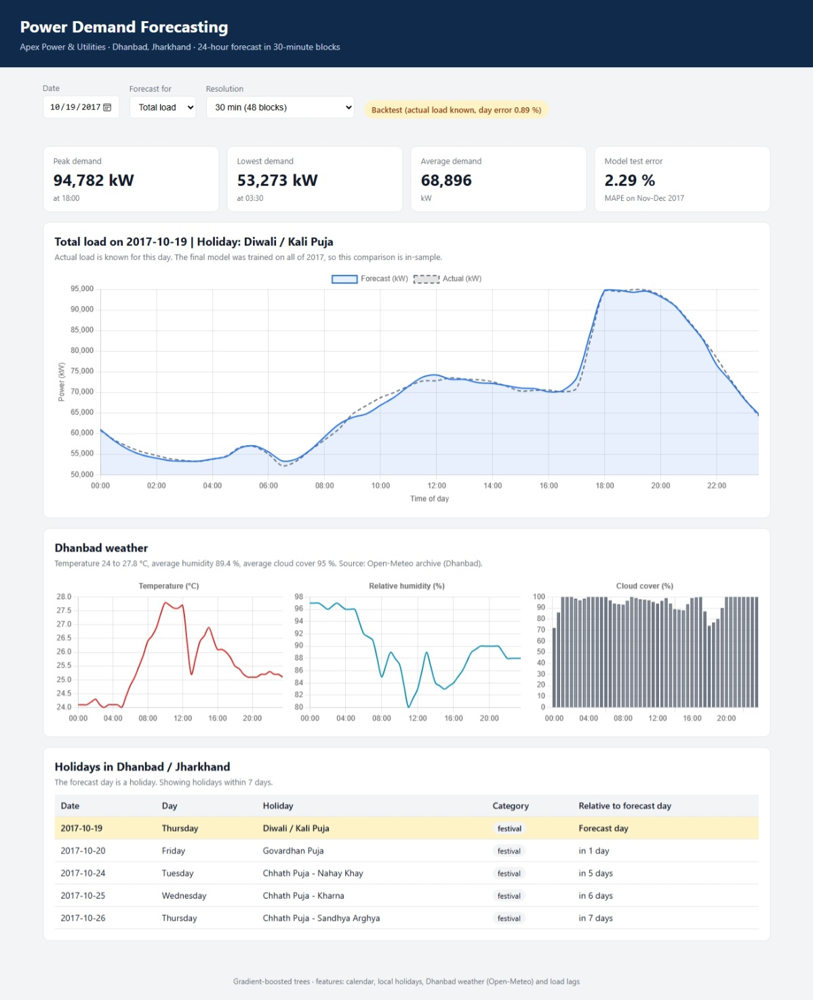

# APU Power Demand Forecasting

A 24-hour electricity demand forecast in 30-minute blocks for Apex Power & Utilities (APU), Dhanbad, Jharkhand. It combines the feeder load data, Dhanbad weather and a local holiday calendar in a gradient-boosted model, served by a FastAPI backend and a web dashboard.

Submitted by: Gaurav Bisen | Data Developer Intern assignment, Exascale Deeptech & AI



## Quick start

**With Docker**
```
docker build -t apu-forecast .
docker run -p 8000:8000 apu-forecast
```

**Without Docker** (Python 3.13)
```
pip install -r requirements.txt
python -m uvicorn backend.main:app --reload
```
Run this from the project folder (the one that contains `backend`, `data` and `models`).

Then open:
- Dashboard: http://127.0.0.1:8000
- API documentation: http://127.0.0.1:8000/docs

The dashboard loads Chart.js from a CDN, so the browser needs internet access.

## Results

The models were trained on 8 Jan - 31 Oct 2017 and tested on 1 Nov - 30 Dec 2017.

| Model | MAPE |
|---|---|
| Naive baseline (same time yesterday) | 3.37 % |
| **Total load** | **2.29 %** |
| Feeder F1 | 2.63 % |
| Feeder F2 | 4.12 % |
| Feeder F3 | 7.12 % |

Adding feature groups step by step: calendar only 14.9 %, + load lags 2.4 %, + holidays 2.36 %, + weather 2.33 %, + season 2.29 %. The load of the same time yesterday and last week matters most. Weather and holidays give small gains, because the weather has only a weak relationship with this load.

## What is in the repository

| Path | Content |
|---|---|
| `01_eda_cleaning.ipynb` | EDA and data cleaning of the load data |
| `02_weather_holidays_features.ipynb` | Dhanbad weather (Open-Meteo), local holidays, feature engineering |
| `03_model_training.ipynb` | Model comparison, justification, training and saving |
| `backend/` | FastAPI application |
| `frontend/` | Dashboard (HTML, CSS, JavaScript with Chart.js) |
| `data/` | Load data, weather, holiday list and feature table |
| `models/` | Trained models (`forecast_models.pkl`) and test metrics |
| `Dockerfile`, `requirements.txt` | Container and dependencies |

The notebooks use relative paths such as `data/...`, so run them from the project folder. They should be read in the order 01, 02, 03.

## API

| Endpoint | Description |
|---|---|
| `GET /forecast?date=2017-12-31&target=Total_Load&interval=30` | Forecast for the 24 hours of a day. `target`: Total_Load, F1, F2, F3. `interval`: 30 (48 blocks) or 15 (96 blocks). |
| `GET /weather?date=2017-12-31` | Dhanbad weather: temperature, humidity, cloud cover, wind speed |
| `GET /holidays?date=2017-12-31&window_days=7` | Local holidays on and around the day |
| `GET /meta` | Valid dates, targets and model accuracy |
| `GET /health` | Health check |

## Design decisions

- **48 or 96 blocks.** The brief mentions both. The default is 48 blocks of 30 minutes; `interval=15` returns 96 points by linear interpolation of the 30-minute forecast.
- **Date range.** The load data covers 1 Jan - 30 Dec 2017, so forecasts can be requested for 8 Jan - 31 Dec 2017. 31 Dec 2017 is a real forecast (no actual load exists). For earlier days the actual load is shown next to the forecast; the final model was trained on all of 2017, so that comparison is in-sample.
- **No data leakage.** The smallest lag is 24 hours, so a 24-hour-ahead forecast only uses information that exists at forecast time.
- **Data issues found.** The date column mixes two month-first formats (`01-02-2017` and `1/13/2017`); reading them day-first silently swaps day and month. The July evening peaks in feeder F3 are a repeating pattern and were kept. Feeder F1 has a sustained level shift on 20 April that was kept as a real event.
- **Holidays.** 34 days compiled from Jharkhand holiday lists and festival calendars (national, festivals, tribal festivals, industrial). Dates of lunar festivals can differ by a day between sources.
- **Weather.** The weather columns in the load file do not belong to Dhanbad, so Dhanbad weather comes from Open-Meteo.

## Limitations

- Only one year of data, so seasonality cannot be validated across years, and the test period is two months.
- The forecast needs the load of the previous days, so the demo is limited to the 2017 data period.
- Holiday dates must be updated for other years.
